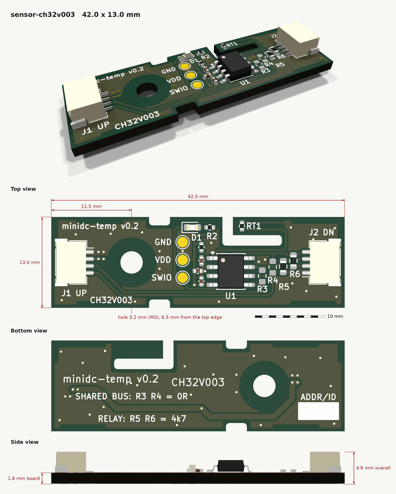

# minidc-temp-monitor

> [!CAUTION]
> **AI in use, use at own risk.**

Cheap temperature monitoring for a **miniature datacenter** with a hot aisle
and a cold aisle. A 42&nbsp;x&nbsp;13 mm **sensor strip board** carries a WCH
RISC-V microcontroller (**CH32V003** or **CH32V005**) and a 100 k NTC
thermistor, with a **JST SH 4-pin** (Qwiic / STEMMA QT style) connector at
each end. Boards daisy-chain on stock cables, and a hub reads the whole chain
over I2C from one end.

A board's address is its position in the chain, so there are no address
straps and the hub sees the boards in their physical order. In a 240-board
build at JLCPCB each board costs $0.30 to $0.33 in parts and $0.58 to $0.97
assembled, before shipping and tax, with the assembly fees calculated from
JLCPCB's published rates.

| `sensor-ch32v003` (SOP-8) | `sensor-ch32v005` (QFN-12) |
| --- | --- |
|  |  |

The KiCad 9 projects are `hardware/sensor-ch32v003` and
`hardware/sensor-ch32v005`. Each has the panel gerbers, parts list and
placement file for an order in `out/panel/`.

Contents:

* [Status](#status)
* [How the chain works](#how-the-chain-works)
* [The two boards](#the-two-boards)
* [What you need](#what-you-need)
* [Getting the boards made](#getting-the-boards-made)
* [Putting a chain together](#putting-a-chain-together)
* [Reading temperatures](#reading-temperatures)
* [Rebuilding the files](#rebuilding-the-files)
* [Further reading](#further-reading)

## Status

| Part | State |
| --- | --- |
| Sensor strip board, v0.2, both versions | drawn, passes ERC and DRC, **not yet built** |
| 16-board assembly panel | drawn, accepted by JLCPCB's and NextPCB's quote pages, not ordered |
| Relay firmware and I2C bootloader | build for both boards and pass tests in a simulated chain, **not yet run on a board** |
| Hub library and command line (`minidc.py`) | tested against the simulated chain only |
| Hub hardware | not designed |
| Humidity sensing | not designed |

Still open: the cable length per aisle and the number of sensor points per
rack face. The known gaps of the board are listed in
[hardware/README.md](hardware/README.md#known-gaps-in-v02), and what the
firmware tests do and do not cover in
[firmware/README.md](firmware/README.md#what-has-been-tested).

## How the chain works

Every cable is its own short I2C bus. On its upstream connector (**J1, UP**) a
board is an I2C target at address `0x2A`. On its downstream connector
(**J2, DN**) it is a bit-banged I2C controller talking to the next board. All
boards use the same address, because each one is alone on its hop.

* **Addressing.** Each command carries a hop count. A board that gets a
  command with a count above zero takes one off and passes it on, and the
  board that sees zero carries it out. Board 0 is the one plugged into the
  hub.
* **Temperatures.** One command reads up to 16 boards in one go, in 0.01 C
  steps. The reading is a ratio of the supply, so it is the same at 3.3 V
  and 5 V.
* **Identify LED.** A command turns on or blinks the LED of one board, to
  find it in the rack.
* **Updates.** Boards take new firmware over the same cable through an I2C
  bootloader, one board at a time.
* **Supply.** 3.3 V or 5 V, passed straight through the chain with no
  regulator on the boards. Never more than 5.5 V.

Because each hop is a fresh bus, cable length does not add up along a chain.
The protocol, the bootloader and the timings are in
[firmware/README.md](firmware/README.md). A shared pass-through bus is a
fitting option on the board
([chain wiring option](hardware/README.md#chain-wiring-option)); the firmware
here is for the relay fitting.

## The two boards

Both versions share the outline, the connectors and every part except the
microcontroller.

| | `sensor-ch32v003` | `sensor-ch32v005` |
| --- | --- | --- |
| Microcontroller | CH32V003J4M6, SOP-8 | CH32V005D6U6, QFN-12 2&nbsp;x&nbsp;2 mm |
| ADC | 10 bit | 12 bit |
| Programming | SWIO test pad | SWIO shares the SCL pin of J1, or the test pad |
| Spare pins | none | two GPIOs and reset on pads |
| Board finish costed | lead-free HASL | ENIG |
| Parts per board | $0.33 | $0.30 |
| 240 boards assembled, JLCPCB | $140 | $233, with X-ray inspection |
| 240 boards assembled, NextPCB | $529 | $651 |

The board has a 3.2 mm hole for an M3 screw, a waist for a zip tie and a flat
back for an adhesive pad or a glued magnet. The thermistor sits on a finger
cut free of the rest of the board. Dimensions, pin use, the copper layout and
the supply voltage limits are in [hardware/README.md](hardware/README.md).

## What you need

### Boards

| Item | Qty | Notes | Details |
| --- | --- | --- | --- |
| Sensor strip board, either version | one per sensor point | Ordered assembled, as panels of 16. | [hardware/README.md](hardware/README.md) |
| Hub | one I2C bus per chain | Anything with a Linux I2C bus (`/dev/i2c-N`), pull-ups on SDA and SCL, and a 3.3 V or 5 V supply for the chain. Every chain needs a bus of its own, and a 200-board build at 3.3 V is at least 10 chains. The pull-ups must suit the chain voltage. | [hub side](firmware/README.md#hub-side), [supply voltage](hardware/README.md#supply-voltage) |
| WCH-LinkE programmer | one | Puts the bootloader and the first application on blank boards. | [programming a blank board](firmware/README.md#programming-a-blank-board) |

### Parts on each board

| Ref | Part | LCSC |
| --- | --- | --- |
| U1 | CH32V003J4M6 or CH32V005D6U6 | C5346354 or C49006243 |
| RT1 | 100 k NTC thermistor, B3950, 1 %, 0402 | C6807762 |
| J1, J2 | JST SH 4-pin, side entry, compatible clone | C7430446 |
| D1 | Red LED, 0603 | C2286 |
| R1, R2, R5, R6, C1 to C3 | Divider, LED and pull-up resistors, decoupling | [full list](hardware/README.md#parts-and-cost) |

### Cables

Generic double-ended JST SH 1.0 mm 4-pin leads from AliExpress, listed at
about $0.10 each, wired straight through: pin 1 at one end reaches pin 1 at
the other. Sellers are expected to call that version "reverse", which is not
confirmed, so check a lead from every lot with a meter. The other version
puts the supply across the wrong pins.

| Lead | Use |
| --- | --- |
| 10, 15 and 20 cm, double-ended | Board to board. The 15 cm lead covers any spacing up to 3U. |
| 30 cm, double-ended | Jumps between rack faces, and a hub with a JST SH socket. |
| 20 cm, single-ended with tinned wires | A hub with pads, pin headers or screw terminals. |

[hardware/CABLES.md](hardware/CABLES.md) has the order list for a 200-board
build (about $41 plus shipping), the listings, and how to tell the two wiring
directions apart.

## Getting the boards made

1. Pick a version. The files are in `hardware/sensor-ch32v003/out/panel/` or
   `hardware/sensor-ch32v005/out/panel/`.
2. Upload `gerbers.zip` to [JLCPCB](https://jlcpcb.com) as a new PCB order
   with the options in the table below.
3. Add assembly, and give it `bom-jlc.csv` and `cpl-jlc.csv` from the same
   folder. They are for the relay fitting.
4. Check the placement preview before paying. The part rotations have not
   been checked against JLCPCB's orientations. On a CH32V005 order, check
   whether X-ray inspection is charged.

| Option | Value |
| --- | --- |
| Size | 107&nbsp;x&nbsp;132 mm panel |
| Panel | "Panel by Customer", 2 columns, 8 rows, 16 boards |
| Quantity | 15 panels |
| Layers | 2 |
| Thickness | 1.6 mm FR-4 |
| Copper | 1 oz |
| Finish | lead-free HASL for the CH32V003, ENIG for the CH32V005 |
| Assembly | Economic, top side, tooling holes "Added by Customer" |

Nobody has placed this order yet. The bare panel price is JLCPCB's online
quote, and its assembly step, which needs a sign-in, has not been reached.

15 panels make 240 boards. [hardware/COST.md](hardware/COST.md) has the cost
line by line, and [hardware/QUOTES.md](hardware/QUOTES.md) compares the
JLCPCB and NextPCB quotes and says which figures are quoted and which are
calculated. The files for NextPCB's quote page are in
`hardware/sensor-*/out/nextpcb/`. The panel itself is described in
[hardware/README.md](hardware/README.md#panel).

## Putting a chain together

1. **Program each board.** Write the bootloader, the application and the
   option word through the SWIO pad with a WCH-LinkE, as in
   [programming a blank board](firmware/README.md#programming-a-blank-board).
   The option word for the CH32V005 has not been checked on a real part. A
   board with no firmware does not pass the bus on, so the chain stops
   there.
2. **Check the cables.** Test one lead from every lot between two unpowered
   boards with a meter before powering anything
   ([wiring direction](hardware/CABLES.md#wiring-direction)).
3. **Chain the boards.** The hub goes to **J1 (UP)** of the first board, and
   each **J2 (DN)** goes to J1 of the next board.
4. **Power it.** One chain runs at one voltage. Keep a 3.3 V chain to about
   20 boards; a 5 V chain can be longer and must have a regulated supply
   ([supply voltage](hardware/README.md#supply-voltage),
   [chain head and hub](hardware/CABLES.md#chain-head-and-hub)). Connect
   the hub before powering the chain: with nothing on J1 of the first board
   the boards may wait in their bootloaders until `minidc.py boot` starts
   them. With CH32V005 boards, keep the hub quiet on the bus for the first
   second after power-on ([bootloader](firmware/README.md#bootloader)).
5. **Find each board.** Scan the chain and blink a board's LED with the
   [hub commands](#reading-temperatures), and write its position in the
   white box on the back.

| Pin of J1 and J2 | Signal |
| --- | --- |
| 1 | GND |
| 2 | VDD, 3.3 V or 5 V |
| 3 | SDA |
| 4 | SCL |

## Reading temperatures

`firmware/tools/minidc.py` is a reference hub in Python, standard library
only. It is a `Chain` class to import and a command line over Linux
`/dev/i2c-N`:

```
python3 firmware/tools/minidc.py --bus 1 scan
python3 firmware/tools/minidc.py --bus 1 temps
python3 firmware/tools/minidc.py --bus 1 led 7 blink 30
python3 firmware/tools/minidc.py --bus 1 update 7 firmware/build/relay-ch32v003.bin
```

A simulated 200-board chain reads in about 21 s at the default 10 kHz per
hop. The hub must end every write with a STOP before it reads, and tolerate
short clock stretching by the first board. The commands, status codes and the update procedure
are in [firmware/README.md](firmware/README.md#protocol).

## Rebuilding the files

The KiCad files are generated by the scripts in `hardware/scripts/`, so
change the scripts and rebuild rather than editing the boards by hand. This
needs KiCad 9, Pillow, openpyxl, the DejaVu fonts and zip:

```
hardware/build.sh
```

It redraws both schematics, boards and panels, runs ERC and DRC, and rewrites
the exports, the renders and `COST.md`.

The firmware builds with GCC for RISC-V and the
[ch32fun](https://github.com/cnlohr/ch32fun) SDK:

```
sudo apt install gcc-riscv64-unknown-elf libnewlib-dev make python3
git submodule update --init firmware/ch32fun
make -C firmware          # images in firmware/build/
make -C firmware test     # host tests
```

CI builds the firmware and runs its tests on every firmware change.

## Further reading

* [Hardware](hardware/README.md): schematics, dimensioned renders, the
  copper layout, the panel, the parts list, supply voltage limits, the chain
  wiring option, notes for firmware and the known gaps.
* [Cost](hardware/COST.md): the price of 240 boards of each version, line by
  line.
* [Production quotes](hardware/QUOTES.md): JLCPCB against NextPCB, and how
  each figure was obtained.
* [Cables](hardware/CABLES.md): what to order, which wiring direction, and
  the lengths for each board spacing.
* [Firmware](firmware/README.md): how the relay works, the protocol, the
  bootloader, recovery, programming a blank board and what has been tested.
* [Research](docs/README.md): surveys of cheap I2C temperature sensors, the
  Qwiic and related connector ecosystems, and JST SH 4-pin connectors and
  their clones.

## Licence

Apache 2.0. See [LICENSE](LICENSE).
