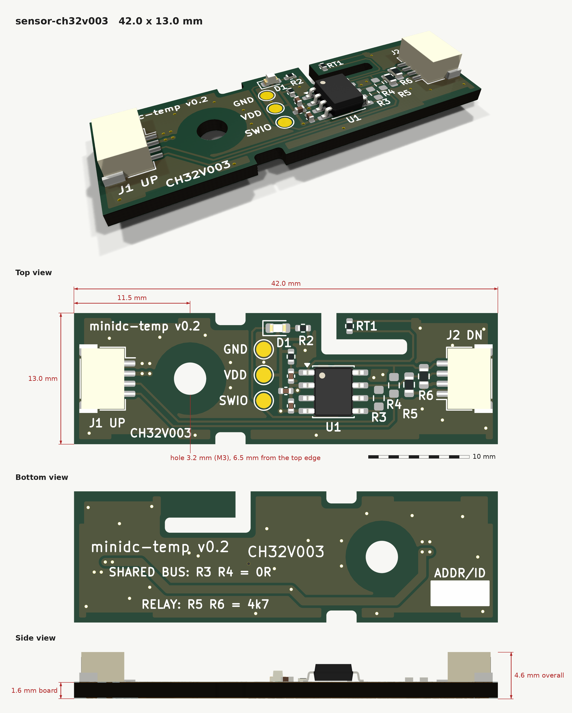
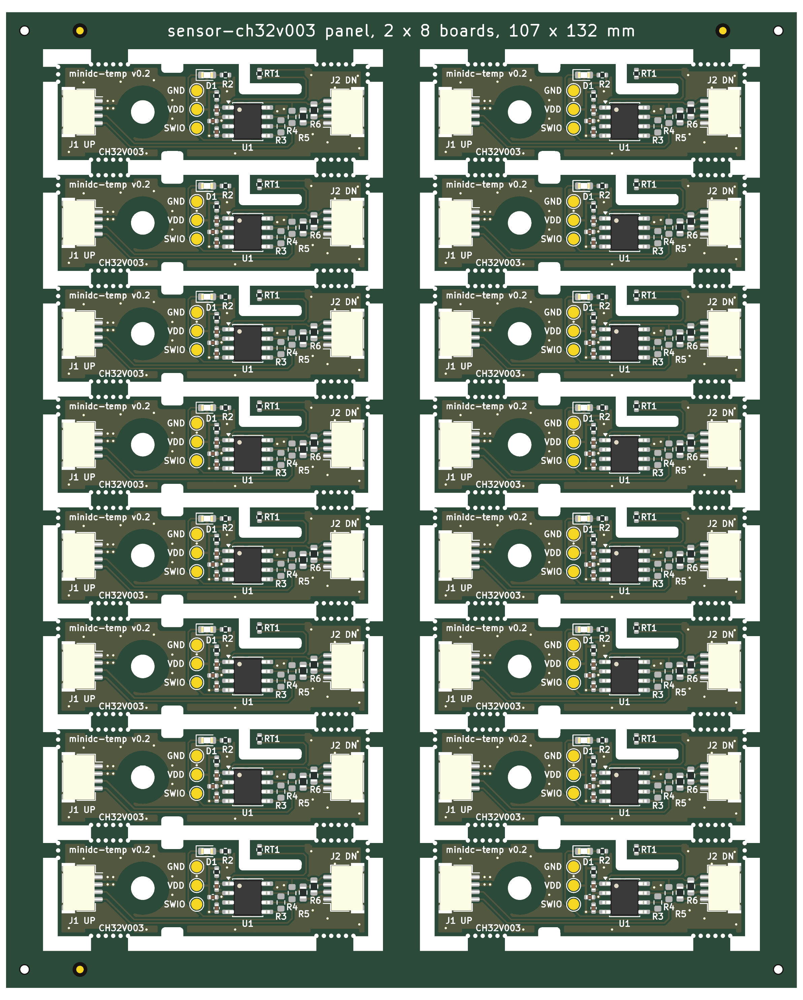

# Hardware: temperature sensor strip, v0.2

A small pass-through board for a chain of temperature sensors on a Qwiic style
(JST SH 4-pin) I2C cable. Each board carries a WCH RISC-V microcontroller that
reads a 100 k NTC thermistor and answers on I2C, so boards can assign their own
addresses instead of using strap resistors.

There are two versions of the same board, differing only in the microcontroller:

| | `sensor-ch32v003` | `sensor-ch32v005` |
|---|---|---|
| MCU | CH32V003J4M6, SOP-8 (LCSC C5346354) | CH32V005D6U6, QFN-12 2x2 mm (LCSC C49006243) |
| ADC | 10 bit | 12 bit |
| Upstream I2C (to J1) | hardware I2C on PC1/PC2 | hardware I2C on PD0/PD1 (remap 1) |
| Downstream I2C (to J2) | bit-banged on PC4 (SDA) and PA2 (SCL) | bit-banged on PC0/PC3 |
| Thermistor divider | fed from VDD, read on PA1 (pin 1, shared with PD6) | fed from PC6 while sampling, read on PC4 |
| Identify LED | shares the SWIO pin (PD1/PD4/PD5) | PA2 |
| Programming | SWIO test pad TP1 | SWIO is the SCL pin, so J1 pin 4 or TP1 |
| Spare pins | none | PA1, PC7 and reset on 1 mm pads (PA1, PC7, RST) |

## Schematic and board

| | Schematic | Board | Parts list | Placement | Checks |
|---|---|---|---|---|---|
| `sensor-ch32v003` | [PDF](sensor-ch32v003/out/schematic.pdf) | [3D views](sensor-ch32v003/out/board-3d.png), [gerbers](sensor-ch32v003/out/gerbers/) | [BOM](sensor-ch32v003/out/bom-jlc.csv) | [CPL](sensor-ch32v003/out/cpl-jlc.csv) | [ERC](sensor-ch32v003/out/erc.rpt), [DRC](sensor-ch32v003/out/drc.rpt) |
| `sensor-ch32v005` | [PDF](sensor-ch32v005/out/schematic.pdf) | [3D views](sensor-ch32v005/out/board-3d.png), [gerbers](sensor-ch32v005/out/gerbers/) | [BOM](sensor-ch32v005/out/bom-jlc.csv) | [CPL](sensor-ch32v005/out/cpl-jlc.csv) | [ERC](sensor-ch32v005/out/erc.rpt), [DRC](sensor-ch32v005/out/drc.rpt) |

The renders below are made by `scripts/render.py` from the board files. The
dimensions on them are read from the board, not typed in.

| | |
|---|---|
| Outline | 42.0 x 13.0 mm, 1.6 mm thick, two layers, 4.6 mm tall over the connectors |
| Parts | top side only; the back is flat for an adhesive pad or a glued magnet |
| J1 (UP), J2 (DN) | JST SH 1.0 mm 4-pin, side entry, facing out of the short edges. Pin 1 GND, 2 VDD, 3 SDA, 4 SCL |
| Mounting hole | 3.2 mm for M3, 11.5 mm from the J1 end, on the centre line, with a 7.2 mm copper-free washer area on both sides |
| Zip-tie waist | 3.0 mm wide, 1.2 mm deep notch in each long edge, 14 to 17 mm from the J1 end |
| Thermistor finger | 2.6 mm wide, 7.0 mm long, cut free by a 1.5 mm slot, no copper pour, RT1 near the tip |
| Test pads | GND, VDD and SWIO: 1.5 mm pads in a column on 2.54 mm pitch, to take a 3-pin pogo clip or header |
| Back | board name and revision, the two chain fittings, and a white box to write the board's address on |

How the copper is laid out:

- The top layer carries every signal. The back is a ground plane crossed by
  one track only: a 0.8 mm VDD trunk from J1 to J2. The microcontroller taps
  the trunk through a via at its decoupling capacitor, so chain current does
  not pass through the microcontroller's supply pad.
- Each connector power pin has two vias. Stitching vias tie the top ground
  pour to the plane.
- R3 to R6 are 0603 so that each can bridge a track on the top layer. That is
  what keeps the back plane whole.
- Copper stays 0.5 mm from every board edge, and 1.0 mm back where the panel
  tabs attach. `gen_pcb.py` checks the pour against the edge on every build,
  because KiCad's DRC does not.
- The CH32V005's only ground is its exposed pad. It has one via in a corner of
  the pad, and solder paste on the rest (60 % of the pad).
- Fabrication class: 0.2 mm tracks, 0.6/0.3 mm vias (0.5/0.3 mm under the
  CH32V005), which is JLCPCB's cheapest two-layer class.

## Panel

JLCPCB assembles small boards as a panel. `scripts/gen_panel.py` builds one for
each version: 16 boards (2 x 8) in a 107 x 132 mm frame, so 13 panels give 208
boards. The cost estimate uses a round 200.

| | Panel board | Gerbers | Parts list | Placement | Check |
|---|---|---|---|---|---|
| `sensor-ch32v003` | [KiCad](sensor-ch32v003/sensor-ch32v003-panel.kicad_pcb) | [zip](sensor-ch32v003/out/panel/gerbers.zip) | [BOM](sensor-ch32v003/out/panel/bom-jlc.csv) | [CPL](sensor-ch32v003/out/panel/cpl-jlc.csv) | [DRC](sensor-ch32v003/out/panel/drc.rpt) |
| `sensor-ch32v005` | [KiCad](sensor-ch32v005/sensor-ch32v005-panel.kicad_pcb) | [zip](sensor-ch32v005/out/panel/gerbers.zip) | [BOM](sensor-ch32v005/out/panel/bom-jlc.csv) | [CPL](sensor-ch32v005/out/panel/cpl-jlc.csv) | [DRC](sensor-ch32v005/out/panel/drc.rpt) |

| | |
|---|---|
| Frame | 5 mm rails on all four sides and a 5 mm rail between the two columns |
| Between boards | 2 mm routed slots |
| Tabs | six per board. Four are 5 mm wide, on the long edges 7.0 and 37.5 mm from the J1 end, to the boards above and below. Two are 2 mm wide, at the top corner of each short edge clear of the connector, to the rail beside the board |
| Mouse bites | 0.6 mm holes on 1.0 mm pitch along each tab's board edge, centred 0.05 mm inside the edge, 0.6 mm or more from copper |
| Fiducials | three on the top and bottom rails, 1 mm copper in a 2 mm mask opening, in the middle of the rail |
| Tooling holes | four, 1.152 mm, unplated, 2.5 mm from the panel corners |
| Designators | each part's own designator plus the board number, for example `R5_07` |

To order: upload `gerbers.zip`, choose "Panel by Customer" with 16 boards per
panel, and give the panel BOM and CPL to the assembly step. The panel is
separated by mouse bites, not V-cuts, because the outline has notches and a
slot and the parts sit close to the edges.

The JLCPCB figures used here (rail width, fiducial and tooling hole sizes,
mouse-bite hole size and spacing) come from JLCPCB's help pages as found on
18 Nov 2026. Their pages do not agree with each other on every number, so
check the panel in JLCPCB's order preview before paying.

## Parts and cost

Both boards share every part except the microcontroller. Prices are JLCPCB
catalogue prices on 18 Nov 2026 for 200 boards; [COST.md](COST.md) has the full calculation,
including estimated fabrication and assembly fees.

| Ref | Part | LCSC | Fitted |
|---|---|---|---|
| U1 | CH32V003J4M6 or CH32V005D6U6 | C5346354 or C49006243 | yes |
| RT1 | 100k NTC, B3950, 1%, 0402 (Sunlord SDNT1005X104F3950FTF) | C6807762 | yes |
| R1 | 100k 1% 0402, divider | C25741 | yes |
| R2 | 1k 0402, LED | C11702 | yes |
| R3, R4 | 0R 0603, shared-bus links | C21189 | no |
| R5, R6 | 4k7 1% 0603, downstream pull-ups | C23162 | yes, optional |
| C1, C3 | 100n 16 V X7R 0402 | C1525 | yes |
| C2 | 1u 25 V X5R 0402 | C52923 | yes |
| D1 | Red LED 0603 | C2286 | yes |
| J1, J2 | JST SH 4-pin, side entry, compatible clone | C7430446 | yes |

| | `sensor-ch32v003` | `sensor-ch32v005` |
|---|---|---|
| Parts per board | $0.33 | $0.30 |
| 200 boards assembled (estimate) | $118 | $114 |

## Cables

Generic double-ended JST SH 1.0 mm 4-pin leads, about $0.10 each from
AliExpress or JLCPCB. They come wired straight or reversed, so check a sample:
pin 1 at one end must reach pin 1 at the other.

## Supply voltage

The boards run from 3.3 V or 5 V on VDD (J1/J2 pin 2) with no fitting change.
There is no regulator: VDD feeds the microcontroller directly and passes
straight through to the next board, so one chain runs at one voltage.

| | At 3.3 V | At 5 V | Limit |
|---|---|---|---|
| CH32V003 supply | ok | ok | 2.7 to 5.5 V, 2.8 V or more for the ADC |
| CH32V005 supply | ok | ok | 2.0 to 5.5 V, 2.4 V or more for the ADC |
| C1, C3 (100n) and C2 (1u) | ok | ok | rated 16 V and 25 V |
| Identify LED through R2 (1k) | about 1.4 mA | about 3 mA | 20 mA |
| R5, R6 pull-up current (4k7) | 0.7 mA | 1.1 mA | 3 mA for standard I2C |
| Thermistor self-heating at 25 C | about 27 uW | about 63 uW | negligible |

- The thermistor reading is ratiometric. The divider and the ADC reference both
  hang off VDD (through PC6 on the CH32V005), so the reading does not depend on
  the supply voltage. Firmware must work from the ADC ratio and never assume a
  VDD value.
- Never put more than 5.5 V on VDD. That is both the operating and the absolute
  maximum of the microcontrollers, and there is no protection on the board, so
  a 5 V supply must be a regulated one.
- 5 V leaves far more room for voltage drop along a long chain than 3.3 V does
  (2.2 V against 0.5 V before the CH32V003 ADC limit).
- The hub must suit the chain voltage. The simple case is hub pull-ups to the
  same rail as VDD. A 3.3 V hub can also drive a 5 V chain if its pull-ups go
  to 3.3 V, because both microcontrollers read 3.3 V as high at VDD = 5 V
  (input high threshold about 2.1 V on the CH32V003 and 2.2 V on the
  CH32V005). That relies on the boards never driving SDA or SCL high, so
  firmware must only ever pull the upstream I2C pins low or release them. Do not pull the bus up to 5 V on
  a 3.3 V chain.
- No signal may go above VDD. The CH32V005 has no 5 V tolerant pins, and on the
  CH32V003 only the upstream I2C pins are. Set the debug probe to the chain
  voltage or lower: a 3.3 V probe works on a 5 V board, a 5 V probe on a 3.3 V
  board does not.
- Qwiic and STEMMA QT cables and the JST SH connectors carry either voltage,
  but standard Qwiic boards are 3.3 V only. Do not plug one into a 5 V chain.

## Chain wiring option

| Mode | R3, R4 (0R) | R5, R6 (4k7) | Behaviour |
|---|---|---|---|
| Relay (default) | not fitted | fitted (optional) | Each board is an I2C target upstream and a bit-banged controller downstream, and forwards traffic. Every hop is a fresh, short bus. |
| Shared bus | fitted | not fitted | SDA/SCL pass straight through. All boards share one bus. |

R5 and R6 are optional. The microcontrollers have internal pull-ups of 35 to
55 k, which carry a short hop at roughly 10 to 20 kHz, so a relay board also
works with R5 and R6 left off. With them fitted a hop runs at 100 kHz and holds
the bus better against noise. They are in the BOM and placement files; delete
their rows from both to build without them.

The BOM and placement files are for the relay fitting. R5 and R6 are the pull-ups
of the hop to the next board; the hop from the hub to the first board uses the
pull-ups on the hub. In shared-bus mode no pull-ups are fitted on the boards.

A relay-fitted board with no firmware does not pass the bus on, so the chain
stops at the first unprogrammed board.

## Files

Everything is generated by the scripts, so change the scripts and rebuild rather
than editing the KiCad files by hand (hand edits are lost on the next build).

- `scripts/gen_sch.py` draws the schematic and checks it against its pin table.
  It also writes `lib/minidc.kicad_sym` (the MCU symbols, adjusted so pin text
  does not collide) and the `sym-lib-table` in each project directory.
- `scripts/layout.py` is the board layout itself: where every part, track,
  via and label goes, in millimetres from the board's top left corner.
- `scripts/gen_pcb.py` builds the board file from the schematic's netlist and
  `layout.py`, and pours ground.
- `scripts/gen_panel.py` builds the assembly panel and its parts list.
- `scripts/render.py` draws the dimensioned 3D views.
- `scripts/gen_models.py` writes the two 3D models KiCad's library lacks (the
  connector and the QFN-12) into `3dmodels/`, which also holds the stock KiCad
  models the renders use.
- `scripts/cost.py` prices both boards from their parts lists and writes
  [COST.md](COST.md).
- `build.sh` runs all of the above for both versions, with ERC and DRC, and
  stops if either reports anything.
- `sensor-*/out/` holds the schematic PDF, the 3D views, gerbers, the BOM and
  placement files in JLCPCB column layout, and the ERC and DRC reports.
  `sensor-*/out/panel/` holds the panel's gerbers (zipped), a render, its BOM
  and placement files and its DRC report.
- `scripts/sexp.py` is a small reader for KiCad's file format, used by the
  other scripts.

Needs KiCad 9 (`kicad-cli`, the `pcbnew` Python module and the stock footprint
library), Pillow, the DejaVu fonts and zip.

## Notes for firmware

- CH32V005: SCL to J1 is also SWIO, and the debug interface is on after reset.
  Firmware must wait a moment at boot before turning it off and enabling I2C,
  or the board cannot be reflashed. In shared-bus mode R4 joins every board's
  SWIO, so flash a board on its own.
- CH32V005: the divider is powered from PC6. Wait about 25 ms after driving PC6
  high before sampling, so C3 has settled.
- CH32V003: the LED sits on the SWIO pin. Light it by driving PD4 or PD5 low and
  leave PD1 as SWIO. Pin 1 is PD6 and PA1 bonded together and is the thermistor
  input: read it as ADC channel 1 (PA1) and keep PD6 an input.
- R5 and R6 are optional, so in relay mode firmware must work the downstream
  SDA and SCL pins without them: release a line by making the pin an input with
  its pull-up on, and drive it by making the pin an output held low. The
  internal pull-up only exists in input mode. Pick the downstream bit rate to
  suit: 10 to 20 kHz on internal pull-ups alone, up to 100 kHz with R5 and R6.
  Keep the pull-ups off on the upstream pins, and on every bus pin in
  shared-bus mode, so the only pull-ups there are the ones on the hub.
- CH32V003: the ADC and flash writes want VDD of 2.8 V or more, and ADC accuracy
  is only specified above 2.9 V. Watch the drop on long chains, mainly at 3.3 V.
- The allowed ADC speed depends on VDD. Keep the CH32V003 ADC clock at 6 MHz or
  less and the CH32V005 sample rate at 1 MHz or less, so one firmware covers
  both voltages.

## Known gaps in v0.2

- No firmware yet. The default fitting depends on relay firmware. Self-addressing,
  the relay mode and the CH32V005 programming window on the shared SCL/SWIO pin
  are untested ideas until there is some.
- Running without R5 and R6 is untested. Try a few boards with them removed
  before leaving them off a whole build.
- The placement file rotations have not been checked against JLCPCB's part
  orientations. Check the preview when ordering.
- Silkscreen text is 0.8 mm high with a 0.15 mm stroke. JLCPCB's capability
  page asks for 1.0 mm, and there is no room for that on this board, so some
  designators may print soft.
- On the CH32V003 board C1, C2, C3 and R1 have no designator: there is no room
  beside them. From the top they are R1, C3, C2, C1 in the column left of U1.
- CH32V005: the ground via sits in the exposed pad and is open on the top
  side, so some solder can run into it. The QFN is 0.4 mm pitch; ask JLCPCB
  whether their standard HASL finish is acceptable for it or whether it needs
  ENIG, which costs more. [COST.md](COST.md) assumes the standard finish.
- The panel follows JLCPCB's published rules as far as they could be read, but
  JLCPCB has not reviewed it.
- On the CH32V005 board the SDA line leaves J1 under the connector housing.
  The stock footprint has no copper there, but the fit under the clone part
  has not been checked on a real board.
- The JST SH connector part is a compatible clone (LCSC C7430446). Its drawing
  shows the leads and mounting tabs landing on the JST footprint used here (see the
  [connector survey](../docs/research/jst-sh-4pin-connectors.md#land-pattern-of-the-fitted-part)),
  but no part has been soldered to the footprint or mated with a cable yet.
